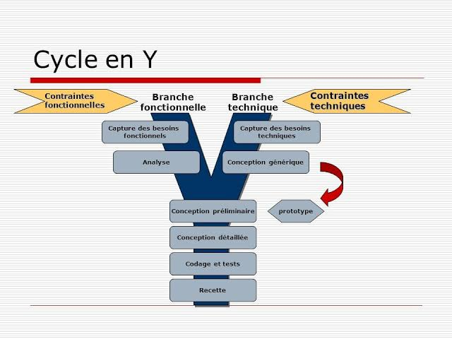

## 2.3 2TUP

### Définition

La méthode **2TUP** (*Two Tracks Unified Process*) est une méthode de
développement logiciel agile et itérative. Elle peut être adaptée au contexte
de **[Nom du projet]**, à ses objectifs et aux besoins de **[utilisateurs ou
organisation]**.

Sa particularité repose sur une architecture en « Y » qui sépare
distinctement deux axes de réflexion :

- **la branche fonctionnelle**, consacrée à la compréhension des utilisateurs,
  des processus et des besoins métier ;
- **la branche technique**, consacrée à l'étude des contraintes techniques,
  à la conception de l'architecture et au choix des technologies.

La branche fonctionnelle permet de définir **[fonctionnalités ou besoins
principaux]**, tandis que la branche technique permet de déterminer
l'architecture et les outils nécessaires, tels que **[langages, frameworks,
base de données ou services]**.

Ces deux branches progressent en parallèle, puis se rejoignent dans une phase
de réalisation. Cette organisation permet de limiter les risques, de vérifier
la cohérence entre les besoins métier et la solution technique, et de faire
évoluer progressivement le produit.

### Schéma

Le schéma suivant présente le fonctionnement général de la méthode 2TUP.
Les éléments entre crochets peuvent être remplacés par les informations
propres à chaque projet.

**Figure [numéro] : Processus 2TUP appliqué à [Nom du projet]**

La branche fonctionnelle part de la capture des besoins et aboutit à
l'analyse fonctionnelle. En parallèle, la branche technique part des besoins
techniques et aboutit à la définition de l'architecture et des technologies.
La convergence des deux branches déclenche la phase de réalisation, qui
comprend la conception, le codage, les tests, la recette et le déploiement.

### Conclusion

La méthode 2TUP fournit un cadre de travail structuré et adaptable pour la
réalisation de **[Nom du projet]**. La séparation entre les branches
fonctionnelle et technique facilite la compréhension des besoins et permet de
prendre les décisions techniques au moment approprié.

En réunissant ces deux branches dans une phase de réalisation progressive,
la méthode favorise la maîtrise des risques, l'amélioration continue et
l'alignement du produit final sur les besoins de **[utilisateurs ou
organisation]**. Elle constitue ainsi une approche pertinente pour les
projets dont les exigences fonctionnelles et les contraintes techniques
doivent être analysées conjointement.
