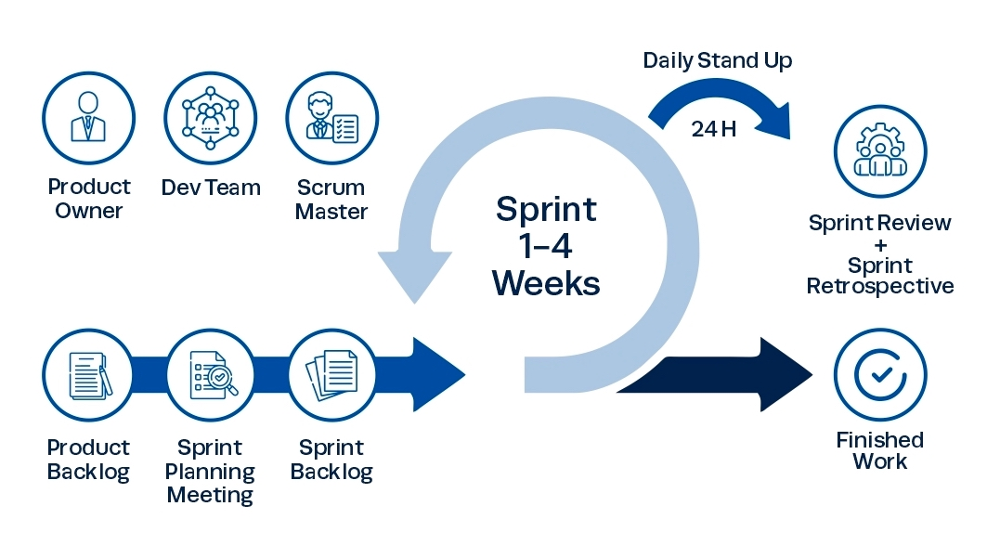

# Méthode de travail

## La méthode SCRUM

La méthodologie Scrum est une méthodologie agile qui permet de gérer un projet de manière flexible et collaborative, en favorisant la livraison progressive de fonctionnalités. Elle repose sur l'itération, la priorisation des tâches et la communication régulière entre les membres de l'équipe. Dans le cadre de ce projet Promatch, nous avons organisé le travail selon les principes de Scrum, ce qui nous a permis de mieux planifier, suivre et livrer les différentes fonctionnalités de manière efficace.

*Figure 3 : La méthode SCRUM*

**Principe Scrum :**

- **Transparence** : visibilité complète sur les tâches, les objectifs et l'avancement du projet pour toute l'équipe.
- **Inspection** : évaluation régulière à la fin de chaque sprint afin d'identifier les erreurs, les blocages et les axes d'amélioration.
- **Adaptation** : ajustement du plan de travail en fonction des retours et des résultats obtenus lors des sprints.

**Organisation du projet en sprints :**

### Sprint 1

-

### Sprint 2 :

-
