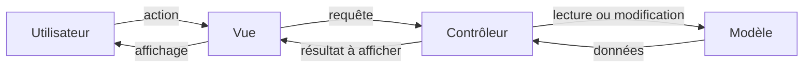
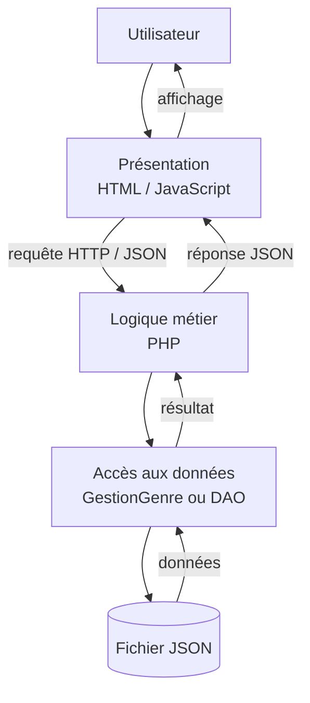
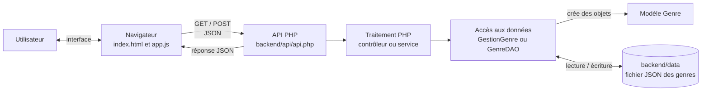

# Architecture du système

## Architecture MVC

Le modèle MVC répartit une application en trois rôles :

- **Modèle** : représente les données et les règles qui leur sont liées.
- **Vue** : affiche les informations et reçoit les actions de l’utilisateur.
- **Contrôleur** : reçoit une action, sollicite le modèle et transmet le résultat à la vue.

_Figure 1 — Échange MVC : le contrôleur coordonne la vue et le modèle lors d’une requête._

Dans le projet, MVC sert de **repère de compréhension**, mais n’est pas appliqué strictement : l’interface HTML/JavaScript est côté navigateur, tandis que le point d’entrée PHP et les classes de traitement jouent les rôles de coordination. La classe `Genre` représente les données métier.

## Architecture 3-tiers

Cette architecture sépare l’application en couches qui communiquent de proche en proche :

- **Présentation** : interface HTML/JavaScript ; envoie les requêtes et affiche les réponses.
- **Logique métier** : traite les opérations demandées par l’utilisateur.
- **Accès aux données** : lit et écrit les données dans leur support de stockage.

_Figure 2 — Les trois tiers séparent l’interface, le traitement des opérations et le stockage._

## Architecture globale

Le projet permet de consulter et d’ajouter des genres. L’interface du navigateur communique avec une API PHP via `fetch`. Les données sont conservées dans un fichier JSON ; elles ne sont pas stockées dans une base de données relationnelle.

_Figure 3 — Architecture commune aux versions du projet ; les noms des classes varient selon la version._

Le parcours d’une requête est le suivant :

1. `app.js` envoie une requête **GET** pour afficher les genres ou **POST** pour en ajouter un.
2. `api.php` transmet l’opération au traitement PHP, puis à la classe qui lit ou met à jour le fichier JSON.
3. Le résultat est renvoyé au navigateur au format JSON ; l’interface affiche la liste actualisée.
