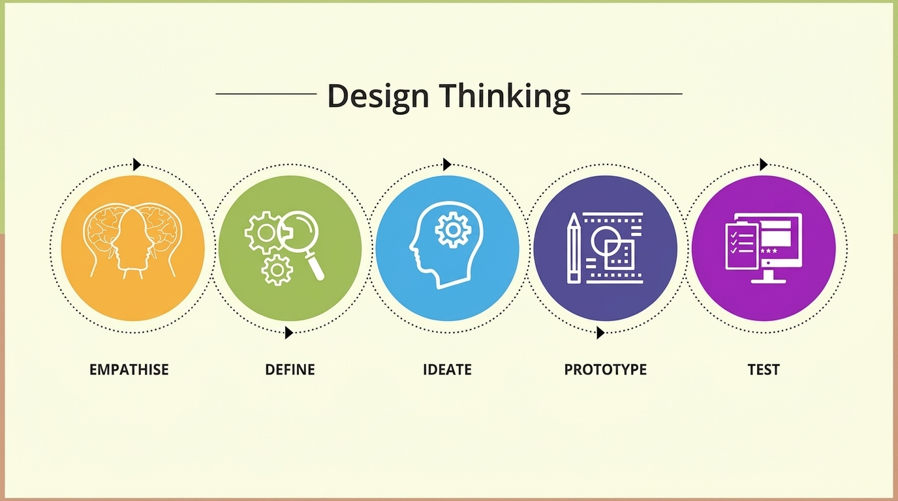

# Design thinking

Ainsi, l’adoption de la méthode Scrum a permis d’assurer une organisation efficace du travail et une meilleure gestion du projet. Elle a contribué à améliorer la qualité des fonctionnalités développées et à garantir un déroulement structuré du projet ImmoSync.

## Design thinking

Le Design Thinking est une approche de résolution de problèmes centrée sur l’humain. Elle vise à comprendre en profondeur les besoins réels des utilisateurs afin de concevoir des solutions innovantes, utiles et adaptées. Cette méthode est largement utilisée dans les domaines du design, de la technologie, de l’éducation et de l’innovation pour répondre à des problématiques complexes.

  

*Figure : Méthodologie Design Thinking*

Le Design Thinking est particulièrement utilisé pour :

- Encourager la créativité et l’innovation dans la conception de solutions ;
- Proposer des réponses réellement adaptées aux besoins des utilisateurs ;
- Favoriser la collaboration entre différentes équipes de travail ;
- Résoudre des problèmes complexes ou mal définis de manière structurée.

## Les étapes du Design Thinking

Le processus du Design Thinking se compose de plusieurs étapes essentielles :

- **Empathie (Empathize)** : cette étape consiste à comprendre l’utilisateur en l’observant, en l’interrogeant et en analysant son comportement. L’objectif est d’identifier ses besoins, ses attentes et ses difficultés réelles.
- **Définition du problème (Define)** : elle permet de regrouper les informations collectées afin de formuler un problème clair et centré sur l’utilisateur, souvent exprimé sous forme de question comme : « Comment pourrions-nous améliorer… ? »
- **Idéation (Ideate)** : cette phase consiste à générer un maximum d’idées possibles sans jugement, en utilisant des techniques comme le brainstorming ou le mind mapping afin de stimuler la créativité.
- **Prototype** : elle consiste à créer une version simplifiée de la solution proposée (maquette, interface ou modèle) afin de tester rapidement les idées.
- **Test** : cette dernière étape permet de tester le prototype auprès des utilisateurs, de recueillir leurs retours et d’améliorer la solution en fonction des résultats obtenus.

Le Design Thinking est donc une méthode structurée et flexible qui permet de transformer une idée en solution concrète en mettant toujours l’utilisateur au centre du processus.
