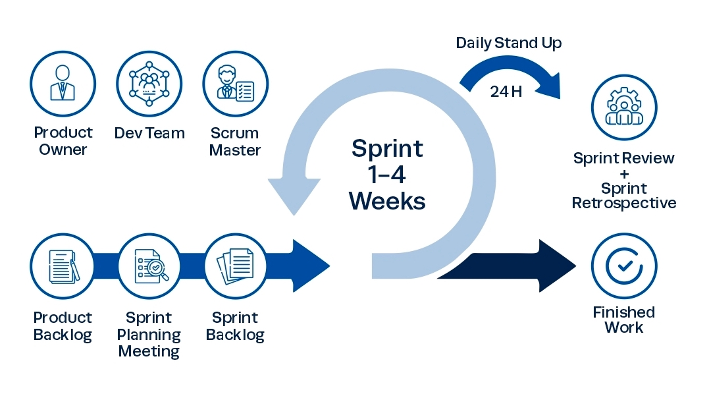
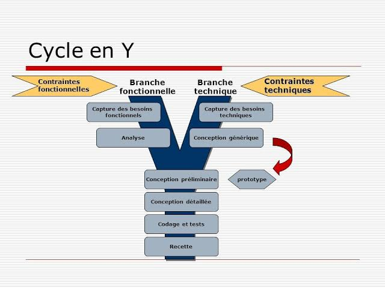
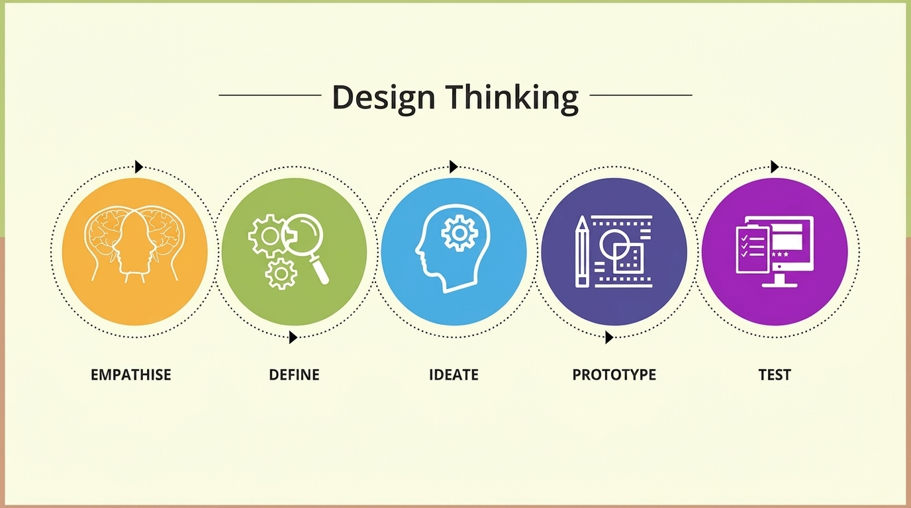

# Rapport du projet fil rouge

> **Note sur les sources :** les documents disponibles mentionnent plusieurs contextes différents : une plateforme de gestion de copropriété, un prototype de livraison de repas, un exemple de gestion de genres et des noms de projets qui ne concordent pas. Les éléments ci-dessous sont donc présentés dans leur contexte documenté, sans les attribuer automatiquement au projet principal.

## Table des matières

- [Remerciements](#remerciements)
- [Introduction](#introduction)
- [Contexte du projet](#contexte-du-projet)
- [Objectif de formation (Solicode)](#objectif-de-formation-solicode)
- [Cahier des charges](#cahier-des-charges)
- [Méthodologie de travail](#méthodologie-de-travail)
  - [Méthodologie Scrum](#méthodologie-scrum)
  - [Processus 2TUP](#processus-2tup)
  - [Design Thinking](#design-thinking)
- [Planification](#planification)
- [Branche fonctionnelle](#branche-fonctionnelle)
  - [Carte d'empathie](#carte-dempathie)
  - [Définition du problème](#définition-du-problème)
  - [Idéation](#idéation)
  - [Diagramme de cas d'utilisation](#diagramme-de-cas-dutilisation)
- [Branche technique](#branche-technique)
  - [Stack technologique](#stack-technologique)
  - [Architecture logicielle](#architecture-logicielle)
  - [Prototype : fonctionnalités et classes](#prototype--fonctionnalités-et-classes)
- [Conception](#conception)
  - [Diagramme de classes](#diagramme-de-classes)
  - [Maquettes](#maquettes)
- [Réalisation](#réalisation)
  - [Interfaces](#interfaces)
- [Conclusion](#conclusion)

## Remerciements

## Introduction

## Contexte du projet

## Objectif de formation (Solicode)

## Cahier des charges

## Méthodologie de travail

### Méthodologie Scrum

Scrum est une méthode agile qui organise le travail en cycles courts et favorise la livraison progressive de fonctionnalités. Elle s'appuie sur trois principes :

- **Transparence** : rendre visibles les objectifs, les tâches et leur avancement.
- **Inspection** : examiner régulièrement le travail réalisé et les éventuels blocages.
- **Adaptation** : ajuster les priorités et le plan de travail à partir des résultats et des retours.

Le document disponible cite des sprints, mais ne précise ni leurs objectifs ni les tâches réalisées. Le nom de projet qu'il mentionne ne concorde pas avec les autres documents ; son application au projet principal reste donc à confirmer.

*Figure 1 — Schéma de la méthode Scrum.*

#### Sprint 1

#### Sprint 2

### Processus 2TUP

2TUP (*Two Tracks Unified Process*) est une démarche itérative organisée autour de deux axes menés en parallèle :

- **Branche fonctionnelle** : compréhension des utilisateurs, des processus et des besoins métier.
- **Branche technique** : étude des contraintes, de l'architecture et des choix technologiques.

Les deux branches convergent vers la réalisation, qui peut comprendre la conception, le développement, les tests et le déploiement. Le document disponible décrit cette démarche de manière générale, sans préciser son application au projet.

*Figure 2 — Schéma général du processus 2TUP.*

### Design Thinking

Le Design Thinking est une démarche de résolution de problèmes centrée sur les besoins des utilisateurs. Elle encourage la collaboration et l'exploration de solutions avant leur mise en œuvre.

Ses principales étapes sont :

1. **Empathie** : observer et interroger les utilisateurs pour comprendre leurs besoins et leurs difficultés.
2. **Définition** : synthétiser les informations recueillies et formuler le problème à résoudre.
3. **Idéation** : proposer plusieurs solutions possibles, sans écarter prématurément les idées.
4. **Prototype** : matérialiser une solution sous une forme simplifiée.
5. **Test** : recueillir les retours des utilisateurs et améliorer la solution.

*Figure 3 — Étapes du Design Thinking.*

## Planification

## Branche fonctionnelle

### Carte d'empathie

### Définition du problème

### Idéation

### Diagramme de cas d'utilisation

## Branche technique

### Stack technologique

Le document consacré à la branche technique présente les choix suivants pour une plateforme de gestion de copropriété immobilière :

- **Backend** : PHP 8.2 ou supérieur et Laravel 12.
- **Gestion des rôles et permissions** : Spatie Laravel Permission 7.4.
- **Application mobile** : NativePHP est cité pour une éventuelle déclinaison mobile.
- **Frontend** : Blade, Tailwind CSS, Alpine et Preline.
- **Compilation des ressources** : Vite.
- **Base de données** : MySQL.
- **Diagrammes** : Mermaid et PlantUML.

Ces choix sont ceux consignés dans le document technique. Aucun fichier de configuration ou code source de l'application principale n'est fourni ici pour les vérifier.

### Architecture logicielle

Le document d'architecture décrit un **exemple distinct de gestion de genres** : une interface HTML/JavaScript communique avec une API PHP et les données sont lues ou enregistrées dans un fichier JSON. Il présente également les notions MVC et trois-tiers.

Cet exemple n'est pas cohérent avec la stack Laravel/MySQL décrite pour la plateforme de gestion de copropriété. En l'absence d'éléments permettant de relier les deux, cette architecture ne peut pas être présentée comme celle du projet principal.

### Prototype : fonctionnalités et classes

Le projet technique préparatoire décrit un prototype CRUD de **livraison de repas**. Il permet à un propriétaire de gérer plusieurs restaurants, les plats de leurs menus et leurs catégories.

Fonctionnalités décrites :

- gérer plusieurs restaurants ;
- ajouter, consulter, modifier et supprimer les plats d'un restaurant ;
- gérer les catégories alimentaires ;
- associer plusieurs catégories à un plat et organiser les plats par catégorie.

Classes et relations documentées :

- `RestaurantOwner` possède plusieurs `Restaurant` ;
- `Restaurant` contient plusieurs `MenuItem` et plusieurs `FoodCategory` ;
- `MenuItem` et `FoodCategory` sont en relation plusieurs-à-plusieurs.

Ce prototype est présenté comme un travail réalisé avant le développement du projet principal ; son lien fonctionnel avec la plateforme de gestion de copropriété n'est pas précisé.

## Conception

### Diagramme de classes

### Maquettes

## Réalisation

### Interfaces

## Conclusion
